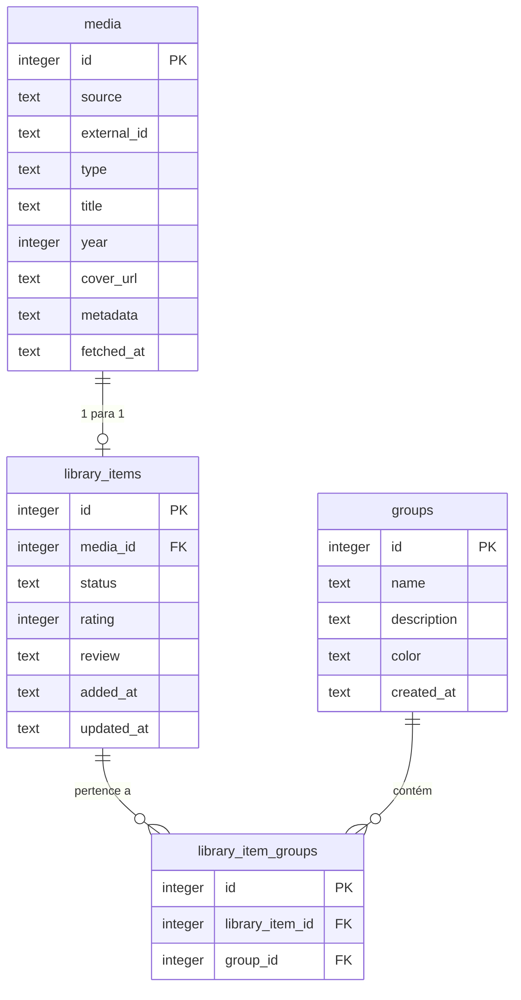

# OmniLog — Documentação Completa da Aplicação

**Versão:** 1.0.0 (MVP Pessoal)  
**Data:** 11 de Outubro de 2026  
**Autor:** @Deivison  

---

## 1. Visão Geral do Projeto

O **OmniLog** é um gerenciador de catálogo multimídia pessoal desenvolvido para centralizar em um único lugar o registro e acompanhamento de:
- 🎮 **Jogos**
- 🎬 **Filmes**
- 📺 **Séries**
- 🌟 **Animes**
- 📖 **Mangás**
- 📚 **Livros**

Projetado especificamente para uso pessoal local, o aplicativo elimina a necessidade de contas em nuvem, custos de hospedagem e configurações multiusuário, utilizando um banco de dados **SQLite** em arquivo local com modo WAL para alto desempenho.

---

## 2. Arquitetura e Tecnologias

| Camada | Tecnologia | Finalidade |
| :--- | :--- | :--- |
| **Framework Fullstack** | Next.js 16 (App Router) + React 19 | Frontend e API Server-Side Routes |
| **Linguagem** | TypeScript | Tipagem estática fim a fim |
| **Estilização** | Tailwind CSS + Lucide Icons | Interface moderna, responsiva em tema escuro nativo |
| **Banco de Dados Local** | SQLite via `better-sqlite3` | Armazenamento local rápido e independente da internet |
| **ORM** | Drizzle ORM | Modelagem de dados, queries tipadas e migrações |
| **Cache & Estado Remoto** | TanStack React Query v5 | Cache de buscas, invalidação automática de estado |
| **Validação de Dados** | Zod | Validação de entradas e schemas de requisições e backups |
| **Controle de Ritmo (Rate Limit)** | `p-limit` | Respeito aos limites das APIs externas (IGDB, AniList, TMDB) |
| **Testes Automatizados** | Vitest | Testes de integração de adaptadores externos |

---

## 3. Modelo de Dados (SQLite)

O banco é criado e inicializado automaticamente em `./data/omnilog.db` com as seguintes tabelas:



### Regras do Banco
1. **Cache com TTL Inteligente**: Itens buscados são cacheados na tabela `media`. Limpezas periódicas de cache removem apenas mídias órfãs (que **não** estão salvas em `library_items`).
2. **Avaliação (Rating)**: Valores inteiros de 1 a 10. Na interface, são convertidos automaticamente para a escala de 5 estrelas (`nota ÷ 2`).
3. **Status de Mídia**: `backlog` (Backlog), `in_progress` (Em andamento), `completed` (Concluído) e `dropped` (Abandonado).

---

## 4. Adaptadores de Mídia e APIs Externas

Todas as consultas externas são feitas estritamente pelo servidor (**Server-Side**), garantindo que nenhuma chave de API vaze para o navegador.

```
                  ┌────────────────┐
                  │ Interface / UI │
                  └───────┬────────┘
                          │ /api/search?q=...&filter=...
                          ▼
               ┌─────────────────────┐
               │  Search Orchestrator │
               └──────────┬──────────┘
       ┌──────────┬───────┴────────┬─────────────┐
       ▼          ▼                ▼             ▼
    [ IGDB ]   [ TMDB ]       [ AniList ]   [ OpenLibrary / GoogleBooks ]
     (Jogos)   (Vídeos)    (Animes / Mangás)           (Livros)
```

1. **IGDB (Jogos)**:
   - Consulta a API v4 de jogos utilizando Twitch OAuth (`Client-ID` + `Client-Secret`).
   - Rate limit controlado em até 4 requisições por segundo.
2. **TMDB (Filmes e Séries)**:
   - Consulta a endpoint `/search/multi` com suporte a idiomas em português (`pt-BR`).
3. **AniList (Animes e Mangás)**:
   - API GraphQL aberta (`https://graphql.anilist.co`).
   - Filtro dedicado entre `ANIME` e `MANGA`, resolvendo conflitos de títulos homônimos.
4. **Open Library & Google Books (Livros)**:
   - Consulta prioritária no Open Library REST.
   - Fallback automático para a Google Books API caso o Open Library não encontre resultados.

---

## 5. Rotas de API do Sistema

| Método | Endpoint | Descrição |
| :--- | :--- | :--- |
| `GET` | `/api/search` | Orquestra a busca externa com filtros (`all`, `game`, `video`, `anime`, `manga`, `book`). |
| `GET` | `/api/library` | Lista itens da biblioteca com filtros por status, tipo de mídia, grupos e ordenação. |
| `POST` | `/api/library` | Adiciona uma mídia à biblioteca (status padrão: `backlog`). |
| `PATCH` | `/api/library/[id]` | Atualiza status, nota (1 a 10) e resenha privada do item. |
| `DELETE` | `/api/library/[id]` | Remove o item da biblioteca (mantendo ou limpando cache). |
| `GET` | `/api/groups` | Lista todos os grupos/coleções com a contagem de itens em cada um. |
| `POST` | `/api/groups` | Cria uma nova coleção/grupo com cor personalizada. |
| `DELETE` | `/api/groups/[id]` | Exclui um grupo específico. |
| `POST` | `/api/library/[id]/groups` | Adiciona ou remove uma mídia de uma coleção específica. |
| `GET` | `/api/backup/export` | Gera e faz o download de um arquivo `omnilog-backup-YYYY-MM-DD.json`. |
| `POST` | `/api/backup/import` | Lê um arquivo JSON e restaura com segurança todas as mídias, avaliações e grupos. |

---

## 6. Funcionalidades da Interface

### 6.1. Painel da Biblioteca (`/`)
- **Alternância Grade / Lista**:
  - **Grade**: Visualização imersiva em cards com pôster/capa, selo de categoria colorido, seletor de status rápido e campo de avaliação expansível.
  - **Lista**: Visão compacta tabular com colunas para ordenação rápida, status, nota numérica e resumo da resenha.
- **Filtros Combinados**:
  - Filtro por **Status**: Backlog, Em Andamento, Concluído, Abandonado.
  - Filtro por **Categoria**: Jogos, Filmes, Séries, Animes, Mangás, Livros.
  - Filtro por **Coleção / Grupo Personalizado**.
  - Ordenação por **Data de Adição** ou **Título** (crescente/decrescente).
- **Sistema de Coleções (Grupos)**:
  - Botão de gerenciamento com seletor de cores para criar grupos como *"Zerar em 2026"*, *"Favoritos da Vida"*, etc.
- **Backup e Restauração Local**:
  - Botão **Backup Local** no cabeçalho para download instantâneo de segurança do banco em `.json` e restauração a qualquer momento.

### 6.2. Busca de Mídia (`/search`)
- Campo de pesquisa global unificado com debounce e envio rápido.
- Abas por categoria: **Todos**, **Jogos**, **Filmes / Séries**, **Animes**, **Mangás** e **Livros**.
- Identificação instantânea de mídias que já foram adicionadas à biblioteca (mostrando o selo *"Na biblioteca"*).
- Alerta visual instrutivo caso alguma fonte externa falhe ou necessite de configuração no `.env.local`.

---

## 7. Variáveis de Ambiente (`.env.local`)

```env
# IGDB (Twitch Developer Console)
IGDB_CLIENT_ID=pt3ytrwn35tp7lhlfbmadctcainf0a
IGDB_CLIENT_SECRET=

# TMDB (The Movie Database)
TMDB_READ_TOKEN=eyJhbGciOiJIUzI1NiJ9...
TMDB_API_KEY=4bd24db864e7afdbccbc58d3018555d4

# Google Books (Opcional - Fallback)
GOOGLE_BOOKS_API_KEY=

# Banco SQLite local
DATABASE_PATH=./data/omnilog.db

# Dias de retenção de cache
CACHE_TTL_DAYS=30
```

---

## 8. Comandos Úteis

| Comando | Finalidade |
| :--- | :--- |
| `npm run dev` | Inicia o servidor local de desenvolvimento em `http://localhost:3000` |
| `npm run build` | Compila a aplicação para produção e verifica integridade dos tipos TypeScript |
| `npm run start` | Roda a versão de produção compilada |
| `npm test` | Executa a bateria de testes automatizados dos provedores via Vitest |
